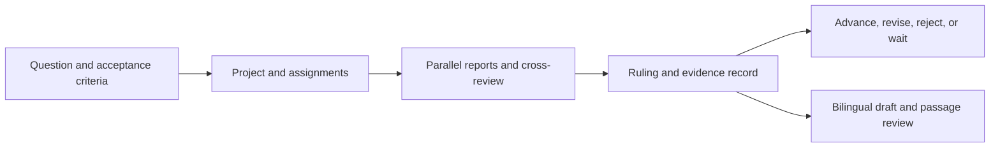

# JoFoundry

[简体中文](README.md) · **English**

**A research workspace that keeps the question, evidence, decision, and next step together.**

JoFoundry is a locally hosted workspace for research with multiple AI models. You define the question and acceptance criteria. A controller assigns work and adjudicates findings. Workers inspect evidence, look for counterexamples, and challenge each other's reports. Pick up the study from saved state and carry reviewed evidence into English and Chinese drafts.

[Quickstart](#quickstart) · [Features and outcomes](#features-and-outcomes) · [Connect models](#connect-models) · [Changelog](CHANGELOG.md) · [MIT](LICENSE)

## Features and outcomes

When a study spans several chats, it is easy to lose track of who checked a claim, which source they used, and what would change the decision. JoFoundry keeps reports, disagreements, rulings, and next triggers in the original project and round.



| Feature | What you can see or control |
| --- | --- |
| **Projects and sessions** | Organize methods, validation, and writing as separate sessions, each with its own objective, materials, instructions, history, and open work. |
| **Multi-model collaboration** | Configure controller, worker, and reviewer roles. Inspect reports, revisions, cross-reviews, and rulings in the round that produced them. |
| **Evidence-first handoffs** | Record the stage, evidence, decision, and next trigger. Resume at a specific point or wait in the original session for missing evidence. |
| **Resumable goals** | Set completion criteria and see the reasons for progress or blockers. Pause or resume automatic continuation, stop a round, and recover persisted state after restart. |
| **Bilingual manuscript review** | Generate sectioned English and Chinese drafts, flag numbers without a match in session materials, and track comments on specific passages. |
| **Configurable providers** | Use compatible local or remote APIs or the Codex CLI. Configure preferred providers, fallback, and optional quota lookups. |

**The reproducible outcome is a traceable workflow.** Follow a synthetic benchmark question from assignment to report and ruling, then inspect the saved record. Tests cover session recovery, routing, and manuscript review. Research quality, empirical outcomes, and API cost depend on the study and model setup. [Tests](tests/) · [Release scope](docs/PUBLIC_RELEASE.md)

## Quickstart

Use **Node.js 22+**. The standalone server uses Node's built-in modules.

```bash
git clone https://github.com/Xiaoqian-Zhang-Shawno/JoFoundry.git
cd JoFoundry
FOUNDRY_MOCK=1 FOUNDRY_HOME="$(mktemp -d)" npm start
```

1. Open the [command workspace](http://127.0.0.1:8787/.research-foundry/command), create a project, and select the evidence-first option (`证据优先`) in the workflow selector (`协作流程`) for the new session.
2. Send a sample question: “Review a synthetic benchmark comparison. Check whether the splits and metrics are comparable, and list the evidence and missing controls separately.”
3. Expand the round to inspect the reports and ruling. Open the research track tab (`主线`) for the stage, decision, and next trigger. Submit missing evidence in that session to resume a waiting goal.
4. With configured models, select the same session in [manuscript review](http://127.0.0.1:8787/.research-foundry/review) to generate and review a draft.

Mock mode uses synthetic responses and makes no model-service calls. The status listener defaults to port `8788`. If the default ports are occupied, append `-- --port 18787 --status-port 18788` and open the workspace on port `18787`.

The evidence workflow covers problem definition, minimal checks, iteration, full validation, and results audit. Each round records an advance, revision, candidate rejection, or wait decision. A waiting goal keeps its objective until you submit more evidence. Existing sessions retain their workflow.

## Connect models

The default setup has one controller and one worker. Set compatible endpoints and model IDs in your shell, then verify one short manual round.

```bash
export FOUNDRY_CONTROLLER_BASE_URL='http://localhost:1234/v1'
export FOUNDRY_CONTROLLER_MODEL='YOUR_CONTROLLER_MODEL'
export FOUNDRY_WORKER_BASE_URL='http://localhost:1234/v1'
export FOUNDRY_WORKER_MODEL='YOUR_WORKER_MODEL'
npm start
```

- **Authentication.** Set `FOUNDRY_CONTROLLER_API_KEY` or `FOUNDRY_WORKER_API_KEY` if required. See [.env.example](.env.example).
- **Model interfaces.** Use a Chat Completions-compatible URL for `openai`, a service root URL for `anthropic`, or a signed-in compatible CLI for `codex`.
- **Multiple roles.** Save the [example config](examples/config.example.json) as `config.json` in the runtime directory. Use `protocol.controller`, `protocol.workers`, and `protocol.reviewers` to set roles. Configure distinct worker lanes to see cross-model review.
- **Providers.** Use `providers` and `active` to select a preferred provider. Fallback may send the same prompt to another configured provider. Quota lookups are opt-in.

Sessions, memory, and artifacts are stored locally. The default runtime directory is `~/.dsh/research-foundry/`. Use `FOUNDRY_HOME` to choose another directory. Selected materials and knowledge sources can enter provider prompts. The unauthenticated web UI binds to loopback by default. The public Codex adapter uses a read-only sandbox. Training, GPU scheduling, and remote execution require separate integration.

## Development and verification

```bash
npm test
npm run check:privacy
FOUNDRY_MOCK=1 FOUNDRY_HOME="$(mktemp -d)" npm run mock
```

[Engine](lib/engine/) · [Web UI](lib/gui/) · [CLI help](lib/CLI_HELP.txt)

The evidence workflow draws inspiration from the research iteration and review described in [ScientistTwo](https://arxiv.org/abs/2609.19644). Researchers make the final decisions in JoFoundry.
