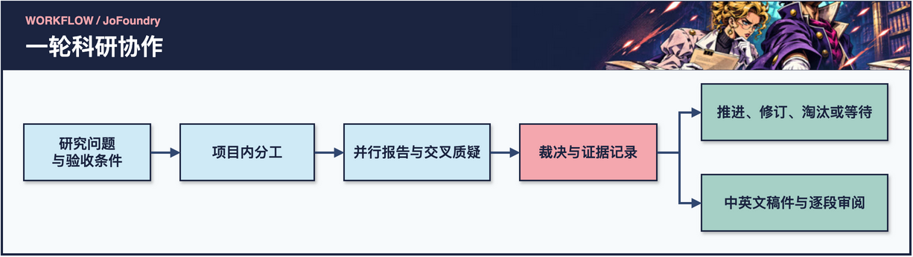
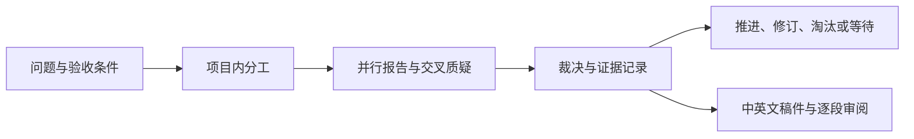

# JoFoundry


**简体中文** · [English](README.en.md)

**把研究问题、证据、裁决和下一步留在同一个工作台。**

JoFoundry 是一个本地托管的多模型科研工作台。你设定问题和验收条件，主持模型拆解与裁决，执行模型检查证据、提出反例、质疑彼此的报告。研究负责人可以在网页追溯结论，隔天从保存的状态继续，并把已核对的证据带进中英文稿件。

[快速开始](#快速开始) · [功能与成效](#功能与成效) · [会话走查](#会话走查) · [连接模型](#连接模型) · [更新日志](CHANGELOG.md) · [MIT](LICENSE)

## 快速开始

需要 **Node.js 22+**。独立服务使用 Node 内置模块，可直接运行。

```bash
git clone https://github.com/Xiaoqian-Zhang-Shawno/JoFoundry.git
cd JoFoundry
FOUNDRY_MOCK=1 FOUNDRY_HOME="$(mktemp -d)" npm start
```

1. 打开[总控协作](http://127.0.0.1:8787/.research-foundry/command)，新建一个项目，将新会话的「协作流程」设为「证据优先」。
2. 发送示例问题「审阅一份合成的基准对照。检查数据划分和指标是否可比，分别列出已有证据与缺少的对照。」
3. 展开回合查看报告与裁决。切到「主线」查看证据阶段、验收决定和恢复条件。等待时，在同一个会话补交所需证据即可接续。
4. 接上实际模型后，可在[人机审稿](http://127.0.0.1:8787/.research-foundry/review)选同一会话生成草稿并逐段审阅。

Mock 模式使用合成回复，无需密钥，也不调用模型服务。状态端口默认为 `8788`。如果默认端口已占用，在启动命令末尾加 `-- --port 18787 --status-port 18788`，从 `18787` 打开网页。

证据优先流程覆盖问题定义、最小验证、复核迭代、完整验证和成果审计。每轮记录继续、修订、淘汰候选或等待。若还缺关键证据，续航可以保留原目标并等待补件。既有会话沿原工作流继续。


## 功能与成效

在多条聊天中推进同一课题时，最容易丢的是证据与结论之间的联系。JoFoundry 把报告、分歧、裁决和后续条件记录到原项目与原回合，让负责人知道现在哪一步可以继续。

[](assets/readme/workflow-zh.webp)

[可编辑源图（draw.io）](assets/readme/workflow-zh.drawio)

<details>
<summary>展开 Mermaid 流程图</summary>



</details>

| 功能 | 你能看到或控制什么 |
| --- | --- |
| **项目与会话** | 方法、验证与写作可以分开进行。每个会话保留自己的目标、材料、指令、历史和待办。 |
| **多模型协作** | 配置主持、执行和评审线路。展开回合查看原始报告、补写、互审和裁决。 |
| **证据优先接续** | 将当前阶段、依据、决定和下一触发条件随回合登记。证据未到时留在原会话等待。 |
| **可恢复目标** | 设置目标与完成条件，查看阻塞和进展理由。启停自动续航或停止当前回合，服务重启后可接回已持久化的状态。 |
| **中英文稿件审阅** | 从会话材料生成分节草稿，标记未在材料中匹配到的数值，选段提意见并跟踪处理。 |
| **自选模型与供应商** | 连接兼容的本地或远程接口，也可配置 Codex CLI。支持配置首选供应商、故障切换和可选额度查询。 |

### 已验证的工作流行为

用同一个本地脚本服务向两种模式返回相同的待件裁决。在这组受控回放中，**普通模式自动多开了 1 轮，证据优先模式自动开了 0 轮**。重启后，证据优先会话保留原目标、裁决和下一触发条件。错误项目的投递返回 HTTP 409，回合和待处理队列保持原样。正确项目补交证据后，在原会话进入 T2。

```bash
node scripts/validate-evidence-handoff.mjs
npm test
```

回放使用合成输入和本地 HTTP，外部模型调用为 0。14 项离线回归还覆盖会话恢复、供应商路由和中英稿件的数字溯源提示。这里测量的是指定场景下的流程行为。研究者耗时、科学结论质量和模型表现尚待对照评估。[结果与复现说明](docs/EVALUATION.md) · [回归测试](tests/) · [发布范围](docs/PUBLIC_RELEASE.md)

## 会话走查

| 阶段 | 你提供什么 | 回合里检查什么 |
| --- | --- | --- |
| 定义问题 | 比较对象、验收条件和已有证据 | 数据划分、指标和对照能否回答同一个问题 |
| 派工与互审 | 本轮可用的材料与约束 | 执行报告、反例、争议点和主持裁决 |
| 处理裁决 | 新证据或对候选方案的取舍 | 推进、修订、淘汰或等待，以及下一触发条件 |
| 整理稿件 | 已核对的会话材料和目标章节 | 分节草稿、数值溯源提示和人工批注 |

> [!TIP]
> 先用合成任务跑一轮。展开报告、互审和裁决，确认你能从结论追到依据，再接入真实材料。

不同问题可分到同一项目下的多个会话。结果跨天才能到时，把缺少的证据与恢复条件留在原会话。写作时，打开该会话对应的审稿界面，从已检查的材料生成草稿。

## 连接模型

默认有一条主持线路与一条执行线路。先配置兼容端点和模型 ID，再跑一个短回合确认连接。

```bash
export FOUNDRY_CONTROLLER_BASE_URL='http://localhost:1234/v1'
export FOUNDRY_CONTROLLER_MODEL='YOUR_CONTROLLER_MODEL'
export FOUNDRY_WORKER_BASE_URL='http://localhost:1234/v1'
export FOUNDRY_WORKER_MODEL='YOUR_WORKER_MODEL'
npm start
```

- **鉴权**。需要密钥的端点使用 `FOUNDRY_CONTROLLER_API_KEY` 或 `FOUNDRY_WORKER_API_KEY`，见 [.env.example](.env.example)。
- **接口**。`openai` 使用 Chat Completions 兼容地址。`anthropic` 填服务根地址。`codex` 使用已安装并登录的兼容 CLI。
- **多角色**。将[配置示例](examples/config.example.json)保存到运行目录的 `config.json`。使用 `protocol.controller`、`protocol.workers` 和 `protocol.reviewers` 分配角色。配置不同的执行线路即可查看跨模型互审。
- **供应商**。通过 `providers` 和 `active` 选择首选线路。发生切换时，同一提示可能被发送给另一已配置供应商。额度查询由用户显式开启。

会话、记忆和产物保存在本地，默认运行目录为 `~/.dsh/research-foundry/`，可用 `FOUNDRY_HOME` 指定其他目录。选入的材料与知识源可能进入模型提示。本机网页默认绑定环回地址，适合个人本地使用。公开版 Codex 适配器采用只读沙箱。GPU 调度、训练和远程执行需要单独集成。

## 运行边界与排查

| 现象 | 优先检查 |
| --- | --- |
| 启动后找不到原会话 | 核对 `FOUNDRY_HOME`。快速开始里的 `mktemp -d` 会创建全新工作区。 |
| 目标进入等待 | 查看「主线」的裁决和下一触发条件，在原项目的原会话补件。 |
| 模型线路失败 | 检查端点、模型 ID、密钥环境变量与活动供应商，再用一条短请求验证连接。 |
| 草稿标记某个数字 | 回到会话材料定位原始表格或记录，逐项人工复核。 |

> [!IMPORTANT]
> 使用远程模型前检查会话材料与供应商回退设置。状态保存在本机，模型请求可以把选入的材料传给配置的供应商。

## 开发与验证

```bash
npm test
npm run check:privacy
FOUNDRY_MOCK=1 FOUNDRY_HOME="$(mktemp -d)" npm run mock
```

[引擎](lib/engine/) · [网页](lib/gui/) · [命令行帮助](lib/CLI_HELP.txt)

证据优先的阶段设计借鉴了 [ScientistTwo](https://arxiv.org/abs/2609.19644) 的研究迭代和评审思路。JoFoundry 的科研取舍由研究负责人决定。
